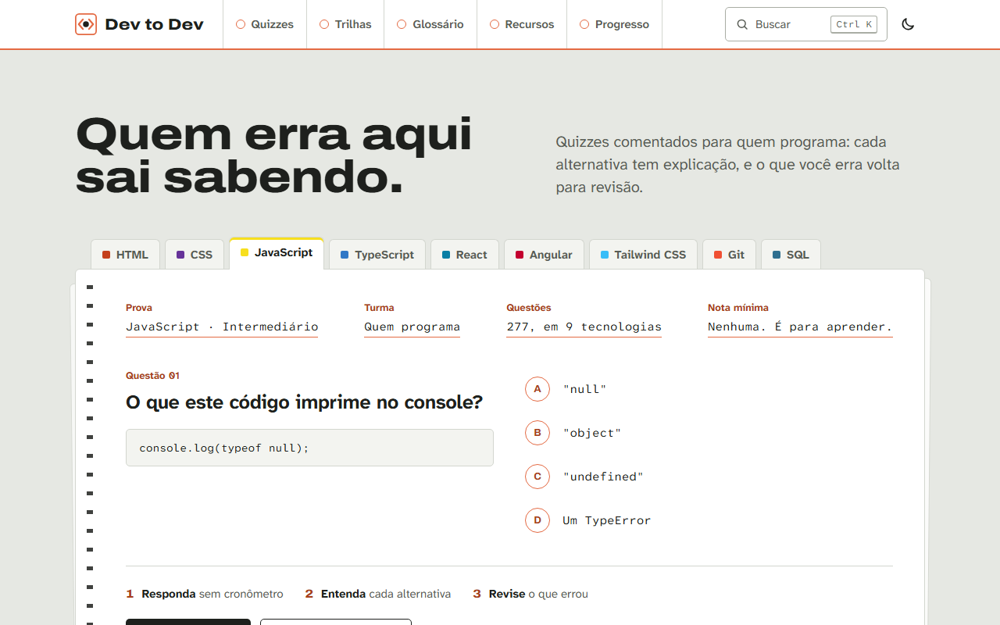
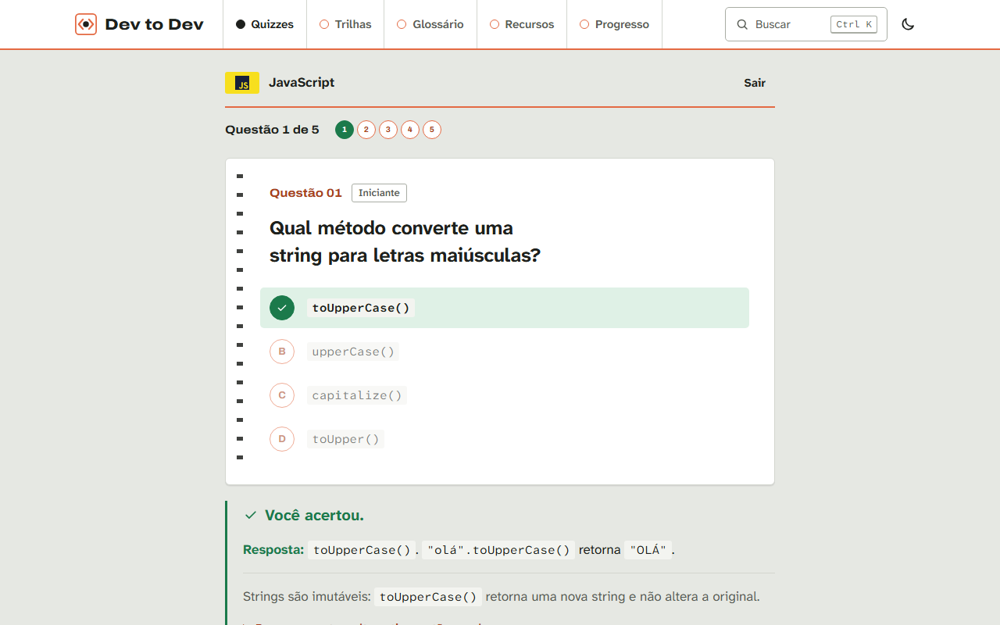
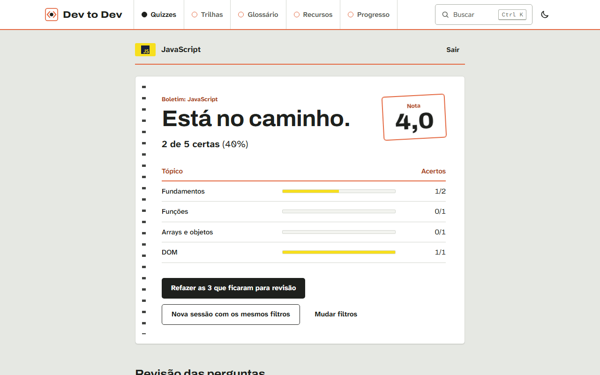
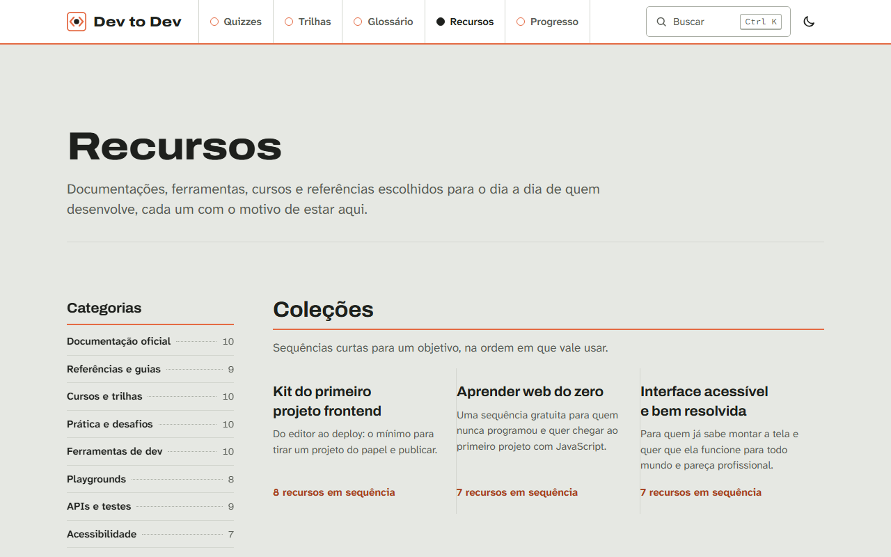
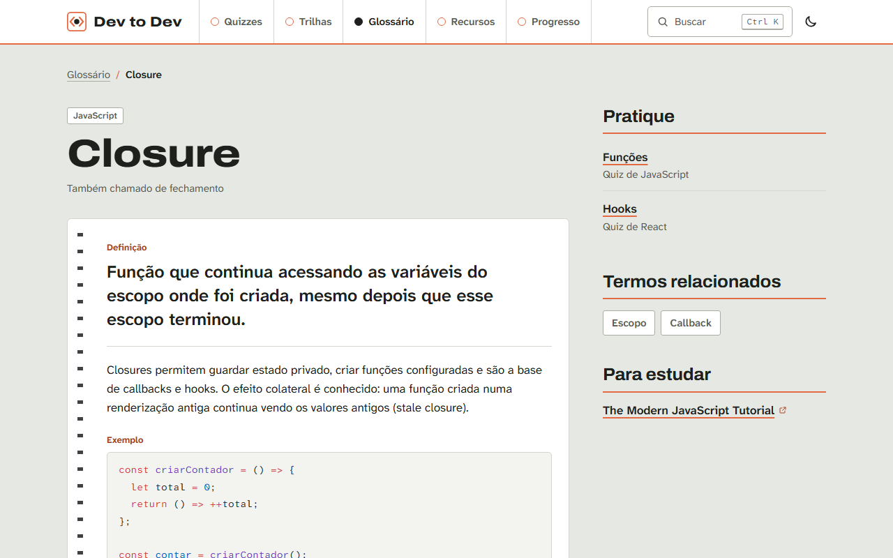
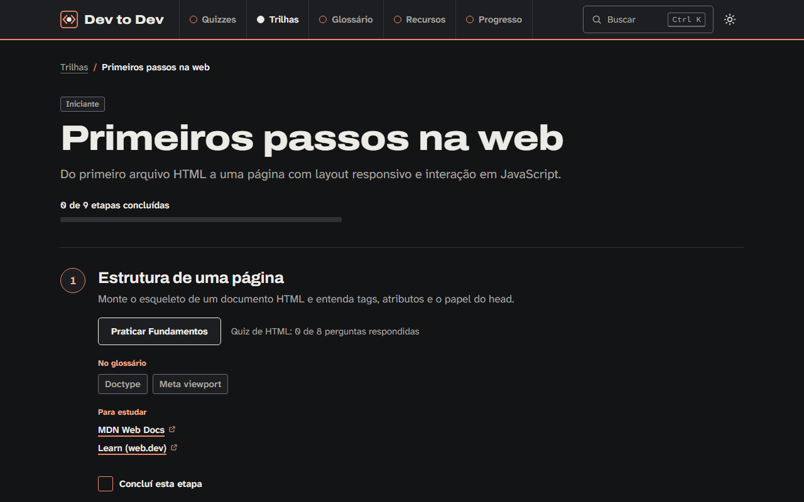
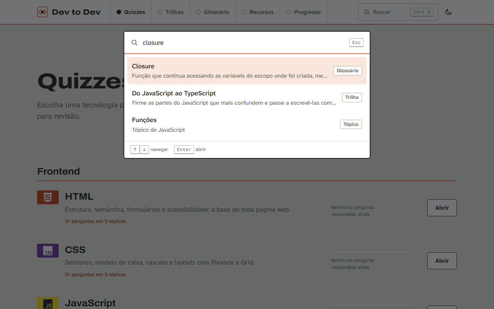
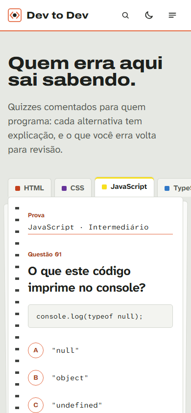
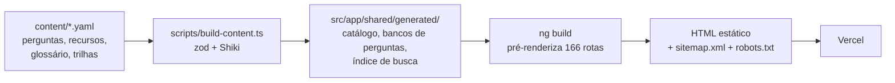

<div align="center">


# Dev to Dev

**Quem erra aqui sai sabendo.** Quizzes comentados de programação, com revisão espaçada, glossário, trilhas de estudo e uma central de materiais selecionados.

[devtodev.vercel.app](https://devtodev.vercel.app/)

<picture>
  <source media="(prefers-color-scheme: light)" srcset="docs/images/home-light.png" />
  
</picture>

</div>

## Sobre o projeto

O Dev to Dev é um site para estudar programação respondendo perguntas, onde o mais importante é o gabarito: **cada alternativa tem explicação, inclusive as erradas**. O que você erra, ou acerta no chute, volta para revisão nos dias seguintes. Tudo fica no navegador, sem cadastro.

É o sucessor do [Front-End Quiz](https://frontend-quiz-cris.vercel.app/), um app de uma tela com 5 quizzes fixos. Aqui o conteúdo cresceu para 9 tecnologias, ganhou explicações, modos de estudo e uma central de materiais, e o site virou páginas estáticas pré-renderizadas, boas para busca e rápidas de abrir.

O visual é inspirado numa **folha de respostas de prova**: folhas brancas sobre uma mesa cinza, campos e bolhas impressos na tinta salmão dos cartões de resposta, grafite para o que você marca e a caneta verde e vermelha do corretor. O tema escuro é papel-carbono.

## Funcionalidades

|                                                                                                                                                                                                            |                                                                                                                                            |
| ---------------------------------------------------------------------------------------------------------------------------------------------------------------------------------------------------------- | ------------------------------------------------------------------------------------------------------------------------------------------ |
|                                                          |                      |
| **Quizzes comentados.** 277 perguntas de HTML, CSS, JavaScript, TypeScript, React, Angular, Tailwind CSS, Git e SQL, em três níveis. Antes de ver a resposta, você diz se tinha certeza, achava ou chutou. | **Boletim por tópico.** Nota de 0 a 10, acertos por tópico, revisão de cada pergunta e um botão para refazer só as que você errou.         |
|                                                                                           |        |
| **Material de apoio.** 135 recursos em 16 categorias, cada um com o motivo da recomendação. Filtros na URL (dá para compartilhar), favoritos e coleções por objetivo.                                      | **Glossário.** 104 termos em poucas linhas, com exemplo de código, termos relacionados, o tópico do quiz para praticar e o que ler depois. |
|                                                                                       |                        |
| **Trilhas de estudo.** 4 trilhas em etapas. Cada etapa junta um tópico do quiz, termos do glossário e materiais, com checklist salvo no navegador.                                                         | **Busca global.** Ctrl+K encontra páginas, quizzes, tópicos, perguntas, termos, trilhas e recursos, sem servidor.                          |

Também tem:

- **Modos de estudo:** prática com feedback imediato, simulado com cronômetro opcional, revisão espaçada (caixas de Leitner) e rodada aleatória misturando tecnologias.
- **Progresso local:** estatísticas por tecnologia, histórico de sessões e backup em JSON para exportar e importar.
- **Tema claro e escuro**, navegação completa por teclado e animações que respeitam a preferência por menos movimento.

<p align="center"></p>

## Tecnologias

| Tecnologia                                                                           | Para quê                                                                                            |
| ------------------------------------------------------------------------------------ | --------------------------------------------------------------------------------------------------- |
| [Angular 22](https://angular.dev/)                                                   | Componentes standalone, signals e detecção de mudanças sem Zone.js                                  |
| [@angular/ssr](https://angular.dev/guide/ssr)                                        | Pré-renderização de todas as rotas no build (`outputMode: "static"`), com hidratação e event replay |
| [Tailwind CSS 4](https://tailwindcss.com/)                                           | Estilos com tokens de design em `@theme` e uma camada de componentes (`.sheet`, `.bubble`, `.btn`)  |
| YAML + [zod](https://zod.dev/)                                                       | Conteúdo escrito em YAML e validado no build; um erro de conteúdo quebra o build com mensagem clara |
| [Shiki](https://shiki.style/)                                                        | Realce de código feito no build, sem JavaScript no navegador                                        |
| [Vitest](https://vitest.dev/)                                                        | Testes unitários de funções puras, stores e serviços                                                |
| [Playwright](https://playwright.dev/) + [axe](https://github.com/dequelabs/axe-core) | Testes E2E em desktop e celular, e checagem de acessibilidade                                       |
| ESLint + Prettier                                                                    | Regras do angular-eslint e formatação, incluindo a ordem das classes do Tailwind                    |
| GitHub Actions + Vercel                                                              | CI a cada push e deploy estático                                                                    |

## Como funciona

O site não tem backend. O conteúdo é transformado em TypeScript no build, e o Angular pré-renderiza cada página em HTML estático:



- Cada banco de perguntas é um chunk carregado sob demanda, e o índice de busca só é baixado quando a busca abre.
- O que é de cada pessoa (progresso, favoritos, trilhas) fica no `localStorage` e só aparece depois da hidratação, então o HTML pré-renderizado é igual para todo mundo.
- SEO: título, descrição, URL canônica, Open Graph e JSON-LD (Quiz, DefinedTerm, Course, ItemList, BreadcrumbList) em todas as páginas.

```text
src/app/
  core/        layout, busca, tema, SEO, armazenamento e progresso
  shared/      componentes, tipos e o conteúdo gerado
  features/    home, quizzes, resources, glossary, paths, progress, about, not-found
content/       perguntas, recursos, glossário e trilhas em YAML
scripts/       pipeline de conteúdo, favicons e checagem de links
e2e/           testes Playwright (specs, page objects, fixtures)
```

Cada feature segue a mesma organização (`components/`, `services/`, `lib/`, `data/`, `constants/`, `interfaces/`) e expõe só o que outras features usam pelo seu `index.ts`.

## Qualidade

- **Acessibilidade:** axe sem violações sérias nas páginas principais, foco gerenciado entre as perguntas, atalhos de teclado (A–D, Enter), `aria-live` no feedback e contraste AA nos dois temas.
- **Desempenho:** Lighthouse no site publicado (celular) com acessibilidade, boas práticas e SEO em 100 e desempenho entre 93 e 97.
- **Testes:** 154 testes unitários e 72 cenários E2E, cada um rodando em desktop e celular (144 execuções).
- **CI:** formatação, lint, checagem de tipos, testes unitários, build e E2E a cada push.

## Rodando localmente

Requer Node.js 22.12 ou superior.

```bash
npm install
npm start          # http://localhost:4200
```

## Scripts

| Comando               | O que faz                                                                                                             |
| --------------------- | --------------------------------------------------------------------------------------------------------------------- |
| `npm run content`     | Valida o conteúdo de `content/` e gera os arquivos em `src/app/shared/generated/` (roda antes de start, build e test) |
| `npm run favicons`    | Baixa para `public/favicons/` o ícone dos domínios de recursos novos (`-- --force` baixa todos de novo)               |
| `npm run check-links` | Confere se as URLs dos recursos e das leituras respondem (falha só com links quebrados)                               |
| `npm run build`       | Build de produção com todas as rotas pré-renderizadas, mais `404.html`, `sitemap.xml` e `robots.txt`                  |
| `npm test`            | Testes unitários                                                                                                      |
| `npm run e2e`         | Testes E2E sobre o build (rode `npm run build` antes; na primeira vez, `npx playwright install chromium`)             |
| `npm run lint`        | ESLint                                                                                                                |
| `npm run typecheck`   | Checagem de tipos dos scripts e dos testes E2E                                                                        |
| `npm run format`      | Prettier                                                                                                              |
| `npm run preview`     | Serve o build localmente                                                                                              |

## Conteúdo

As perguntas ficam em `content/quizzes/<tecnologia>/`: um `meta.yaml` com nome, cor e tópicos, e um arquivo por tópico. Os recursos ficam em `content/resources/`, os termos do glossário em `content/glossary/` (um arquivo por tecnologia, mais `geral.yaml`) e as trilhas em `content/paths/`. O build falha com uma mensagem clara se algo estiver fora do formato (id repetido, nenhuma alternativa correta, linguagem de código não suportada, contraste insuficiente na cor da tecnologia).

```yaml
- id: css-layout-001
  level: beginner # beginner | intermediate | advanced
  prompt: 'Qual propriedade transforma um elemento em container flex?'
  options:
    - text: '`display: flex`'
      correct: true
      explanation: 'Os filhos diretos passam a ser itens flex.'
    - text: '`position: flex`'
      explanation: '`position` não aceita o valor `flex`.'
  explanation: 'Explicação geral, mostrada depois da resposta.'
```

Cada tópico do `meta.yaml` tem de 1 a 3 `links` de leitura (`label` e `url`), mostrados depois de cada resposta como "Para se aprofundar". Uma pergunta pode ter `links` próprios, que substituem os do tópico.

Os ids são estáveis: o progresso salvo no navegador depende deles, então não renomeie ids de perguntas ou recursos já publicados.

## Deploy

O site está publicado na Vercel em [devtodev.vercel.app](https://devtodev.vercel.app/). É um site totalmente estático: o build gera as páginas em `dist/dev-to-dev/browser`, sem servidor nem banco de dados, e o `vercel.json` define o build, os headers de segurança e o cache.

## Créditos

- **Fontes:** Archivo, Atkinson Hyperlegible Next e Atkinson Hyperlegible Mono, sob a SIL Open Font License (veja `public/fonts/`).
- **Ícones das tecnologias:** [Simple Icons](https://simpleicons.org/) (CC0); o de SQL foi desenhado para o projeto. As marcas pertencem aos seus donos.
- **Favicons dos recursos:** baixados pelo `npm run favicons`; pertencem aos respectivos sites.
